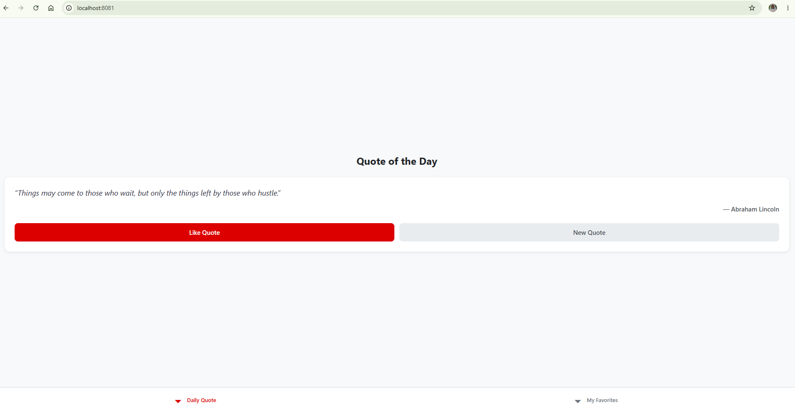
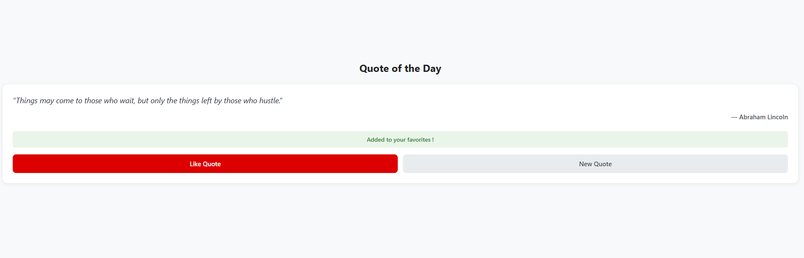
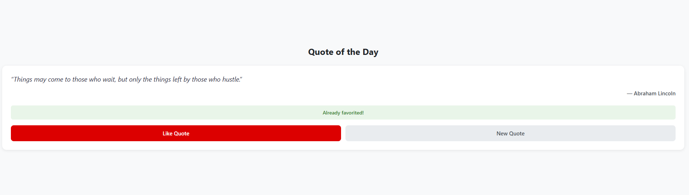
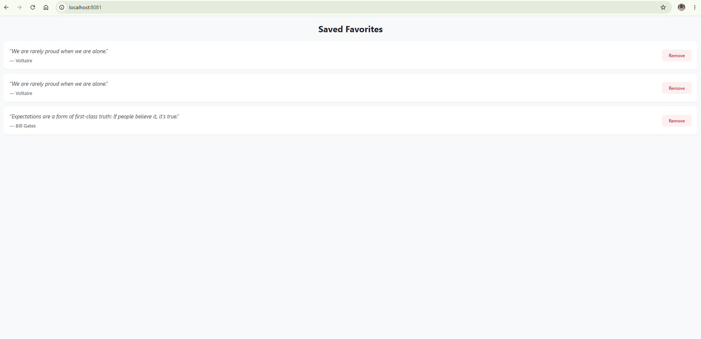
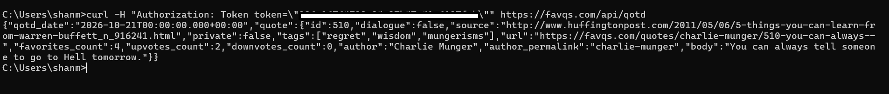

# FavQs Favorites Platform (Backend & Thin Mobile Client)

A case implementation comprising an **Express REST API** (written in TypeScript) that wraps the external FavQs API and manages a user's favorited quotes, paired with a thin **React Native (Expo)** mobile client demonstrating end-to-end functionality.

---

## Visual Showcase

### Client Application UI

| Daily Quote (QOTD) | Liked State | Duplicate Liked State (409) |
| :---: | :---: | :---: |
|  |  |  |

| Saved Favorites (List & Unlike) | LAN Physical Mobile Browser Test | Upstream FavQs Verification |
| :---: | :---: | :---: |
|  |  |  |

---

## Project Structure

```text
favqs-favorites/
├── server/                     # Express REST API
│   ├── src/
│   │   ├── clients/            # Upstream HTTP client (FavQs integration, timeout, headers)
│   │   ├── config/             # Environment validation & CORS origin sanitation
│   │   ├── controllers/        # Request validation, status handling & DTO mapping
│   │   ├── routes/             # Express API routers (/api/quote, /api/favorites)
│   │   ├── services/           # Domain logic & quote response sanitization
│   │   ├── storage/            # In-memory favorites repository with Map (O(1))
│   │   └── index.ts            # App initialization, body parser & error boundary
│   ├── vitest.config.ts        # Vitest test runner configuration
│   └── package.json
├── client/                     # Expo / React Native Thin Client
│   ├── src/
│   │   ├── api/                # Client HTTP wrapper with error normalization
│   │   ├── navigation/         # React Navigation Bottom Tabs (Home, Favorites)
│   │   ├── screens/            # HomeScreen & FavoritesScreen
│   │   └── types/              # Client TypeScript contracts
│   └── package.json
├── docs/                       # For reference and visual presentation
│   ├── postman/
│   │   └── favqs-server.postman_collection.json
│   └── screenshots/
└── .gitignore
└── README.md
```
## Local Setup Instructions
### Prerequisites

- Node.js v18+ (tested on Node 24.11.1)

- npm v9+ (tested on Node 11.6.2)

- A free FavQs API key obtained from [favqs.com](https://favqs.com/)

### Backend Setup (server/)
1. Open your terminal and navigate to the `server/` directory:

```
cd server
npm install
```

2. Create your .env file from .env.example:
```
cp .env.example .env
```

3. Configure your server/.env file:
```
PORT=3000
FAVQS_API_KEY=your_actual_favqs_api_key_here
FAVQS_BASE_URL=[https://favqs.com/api](https://favqs.com/api)
ALLOWED_ORIGINS=http://localhost:8081,http://localhost:3000,[http://127.0.0.1:8081](http://127.0.0.1:8081)
```


> API Key Placement: The **FAVQS_API_KEY** lives exclusively on the server (server/.env) and is never transmitted or exposed to the client application.

4. Start the server in development mode:
```
npm run dev
```
The server will start listening at `http://localhost:3000` 

5. Run the unit tests:
```
npm run test

#Or

npm test
```

### Frontend Setup (client/)
1. In a second terminal, navigate to the `client/` directory:
```
cd client
npm install
```

2. Start the Expo development server:
```
npx expo start
```

3. Launch options:

  - Web Browser (Fastest for review): Press w in your terminal to open the application in your browser at http://localhost:8081.

  - Physical Device (Expo Go / Browser): Scan the terminal QR code using the Expo Go app on your phone, or open the browser on your phone navigating to 
  `http://<YOUR_LOCAL_IP>:3000/api/quote`.
    >  (Note: When running on a physical phone, ensure your computer and phone share the same local Wi-Fi, and set your computer's local LAN IP in client/src/api/quotesApi.ts).

### API Testing with Postman
An exportable Postman collection is provided in the repository at:
`docs/postman/favqs-server.postman_collection.json`

It includes pre-configured requests covering:

- `GET /health` (Server Health Check)

- `GET /api/quote` (Fetch Quote of the Day proxy)

- `POST /api/favorites` (Save a quote to favorites)

- `POST /api/favorites` (Validation error check - 400 Bad Request)

- `POST /api/favorites` (Duplicate quote check - 409 Conflict)

- `GET /api/favorites` (Retrieve favorites list in reverse chronological order)

- `DELETE /api/favorites/:id` (Remove a favorite by ID)

- `DELETE /api/favorites/:id` (Removal non-existent check - 404 Not Found)

---

## Architectural Decisions & Evaluation Answers

### 1. What is implemented ?

- **BFF Proxy Layer** (`GET /api/quote`): Proxies upstream FavQs /qotd, attaching server-side credentials and mapping raw upstream payloads to a sanitized `QuoteDto` (`{ id, body, author }`).

- **In-Memory Favorites Store** (`POST /api/favorites`, `GET /api/favorites`, `DELETE /api/favorites/:id`):

    - Implemented an in-memory repository backed by a TypeScript `Map<number, FavoriteQuote>` for $O(1)$ lookups and deduplication.
    - Enforced strict input validation (type checking, integer verification, string whitespace trimming) returning HTTP `400 Bad Request` on malformed inputs.
    - Handled duplicate favorite attempts with an explicit `409 Conflict` status code.
    - Added reverse chronological ordering (newest favorited quotes returned first).

- **Defensive Gateway Infrastructure:**

    - Configured upstream request timeouts via `AbortSignal.timeout(5000)` to prevent hung sockets from slow external dependencies.
    - Built custom error middleware mapping upstream network failures to standard `502 Bad Gateway` and `504 Gateway Timeout` responses.
    - Implemented a JSON parser error boundary catching malformed request bodies with a `400` status before hitting business logic.
    - Added dynamic, trimmed CORS whitelist parsing with zero-config local defaults.

- **Thin Mobile Client:** Built a tabbed React Native interface with **Daily Quote** (fetch quote, refetch, like) and **My Favorites** (listing via `FlatList`, pull-to-refresh, empty states, and unlike action with optimistic removal).

### 2. Why I implemented or skipped certain things ?

- **Why In-Memory `Map` instead of a Database:** The assignment explicitly permitted in-memory storage for single-user scope. Isolating storage in a dedicated repository class decoupled data access from controllers, provided $O(1)$ operations, and eliminated local setup friction (like running migrations or Docker containers) for reviewers.   

- **Why an Explicit DTO Mapper:** External APIs frequently return vendor-specific metadata (FavQs returns upvotes, downvotes, tags, and permalinks). Stripping this data at the gateway insulates the mobile client from upstream schema changes and reduces payload transfer size.

- **Why `409 Conflict` over Silent Upsert:** Attempting to favorite an already-saved item represents an actionable user event. Returning `409` allows the client UI to render an informed warning banner ("Already favorited!") instead of giving false confirmation of a newly inserted record.

- **Fail-Open Startup on Missing `FAVQS_API_KEY`:** The server starts with a prominent console warning if the key is missing rather than halting the process (`process.exit(1)`). This allows container health probes (`GET /health`) and public quote retrieval to function unhindered (FavQs does not require a token for public `/qotd`), while isolating authorization errors to authenticated endpoints.

- **Skipped User Auth / Session Management:** Omitted authentication as it was explicitly specified as out of scope.

- **Skipped FavQs Search Proxy:** Prioritized hardening core backend contracts, error boundaries, and end-to-end client integration over secondary proxy endpoints.

### 3. What trade-offs were made ?
- **In-Memory storage vs. Zero-Config Portability:** In an In-memory storage - restarting the server wipes saved favorites. However, isolating storage behind a `FavoritesRepository` interface means swapping memory for SQLite or PostgreSQL requires modifying only the repository implementation, leaving controllers and route definitions untouched.

- **Functional Thin UI vs. Custom Design System:** Focused on clean state transitions (loading spinners, error banners, optimistic UI updates, empty states) over complex styling, keeping scope aligned with the requirements.

- **Scoped Unit Tests vs. Full Integration Suite:** Focused automated testing on the core domain storage invariants and response mapping using Vitest rather than mocking full HTTP integration chains with Supertest, ensuring verification of critical business logic under time constraints.

### 4. If I had more time, what would I improve or add? ?

- **Structured Application Logging & Observability:** Add a production-grade structured logger (such as Winston or Pino) including correlated Request IDs, log levels (`debug`, `info`, `warn`, `error`), and HTTP request/response latency logging via middleware.

- **Redis Caching Layer for Quote of the Day:** Add a cache-aside layer in Redis with a 1-hour TTL for `GET /api/quote` to minimize redundant outbound network calls and respect FavQs rate limits.

- **Declarative Schema Validation (Zod):** Upgrade manual controller runtime checks to declarative schema validation using Zod for type-safe payload parsing and automatic error mapping.

- **Persistent Storage Adapter:** Implement a persistent storage driver (e.g., PostgreSQL with Prisma or SQLite) behind the existing `FavoritesRepository` interface, toggled via environment configuration (`STORAGE_DRIVER=memory|db`).

- **Rate Limiting & Abuse Prevention:** Introduce `express-rate-limit` middleware on mutating routes (`POST` and `DELETE /api/favorites`) to safeguard in-memory resources from abuse.
